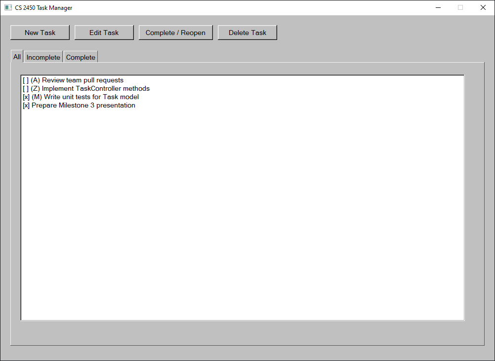

# todo

This to-do list application is a group project for the Fall 2026 CS 2450-003 Software Engineering course.



## Compiling

You will need the [CMake](https://cmake.org/download) build system, at least v3.30 or newer. [Ninja](https://ninja-build.org) is recommended as it is faster than the default options, but it is not required. Install these from their websites or from your operating system's package manager. The examples below assume both are present.

On Debian-based Linux systems, you will also need to install the [libgl-dev](https://packages.debian.org/trixie/libgl-dev) package.
<!-- TODO: Arch-based Linux systems (libglvnd)? Others? -->

```sh
# In the repository root, presumably cs2450-todo/
cmake -S src -B src/build -G Ninja
cmake --build src/build --parallel 4
```

The resulting binary will be at `src/build/todo` or `src\build\todo.exe`.

## Unit tests

Unit tests are implemented using [CTest](https://cmake.org/cmake/help/latest/manual/ctest.1.html), which is built in to CMake. can be built and ran as follows:

```sh
# In the repository root, presumably cs2450-todo/
cmake -S src -B src/build -G Ninja -DCMAKE_BUILD_TYPE=Debug -DBUILD_TESTING=ON
cmake --build src/build --parallel 4
cmake --build src/build --target test
```

## Team Members

- Fawn Sannar <10725695@uvu.edu>
- Ethan Scott <11021379@uvu.edu>
- Porter Sampson <11025503@uvu.edu>
- Jimin Ko <10891833@uvu.edu>
- Mckley Carmebi Leprince Florestal <11076696@uvu.edu>

Former team members:

- Trey Bailey <11015545@uvu.edu>
- Zaq Holdsworth <10946519@uvu.edu>
