# Software Requirements Specification
## Student Task Manager 

**Version** 0.1  
**Class:** CS-2450-003
**Date:** 10-10-2026
**Team:** Fawn Sannar, Ethan Scott, Porter Sampson, Jimin Ko, Mckley Carmebi Leprince Florestal

## Revision History

| Name   | Date       | Reason For Changes                                                                            | Version |
| ------ | ---------- | --------------------------------------------------------------------------------------------- | ------- |
| Porter | 10-10-2026 | Init - Milestone 2                                                                            | 2.0     |
| Porter | 10-28-2026 | Updated requirements, architecture, GUI and UML models to reflect current development status. | 3.0     |

## 1. Introduction & Purpose

This Student Task Manager is a simple application, currently CLI based, designed to help students organize their work. The application provides basic task-management functionality, including creating, viewing, editing, completing, reopening, and deleting tasks. Additional functionality includes task priorities, sorting, and persistent local storage.

This Software Requirements Specification (SRS) documents the application's current requirements, functionality, and system architecture, reflecting changes implemented since the previous milestone.

## 2. Overall Description

**System Context:** The application uses a task structure to represent individual tasks and a controller class to manage task operations and user commands. Tasks are stored locally in a plain-text file following the [todo.txt format](https://github.com/todotxt/todo.txt), allowing task data to persist between program runs.

**Users:** The primary users are students who need a straightforward way to keep track of assignments and other responsibilities. Users are assumed to have basic familiarity with executing applications through a terminal.

**Application Scope:** The application supports creating, viewing, editing, completing, reopening, and deleting tasks. Users can also assign priorities to tasks. The application provides persistent storage, task sorting during saving, and feedback for invalid operations.

### Architectural Design

The application uses a modified MVC approach to organize task data, user interaction, and presentation. 

The current CLI implementation uses a `task_controller ` class to manage task operations and file persistence, while a separate `task_view` class provides methods for displaying task information and messages. 

For the GUI, we've opted to go with [Dear ImGui](https://github.com/ocornut/imgui). Because Dear ImGui handles interface rendering and interactions together, we've chosen to combine View and Controller responsibilities for the GUI rather than strictly separating them into different classes. 
### GUI Design Status

As a part of Milestone 3, Jimin developed GUI wireframes and mockups for the application to implement in the upcoming milestone. These diagrams define an intended layout and user interactions for the future integration of the GUI. 

These designs include five primary screens.
- Main task list
- Empty task list
- Add task
- Edit task
- Delete confirmation

The interface includes task filtering by completion status, optional task priorities, priority-based ordering and confirmation before deletion.

These design represent the current GUI planning and Jimin's design process. The application remains CLI based, and the integration is planned for the next upcoming milestone. 

Design Decisions
- All, Active, and Completed tabs help users filter tasks.
- Task priority is optional (A–Z, with A highest and no priority lowest).
- Tasks are shown in priority order.
- Add and Edit screens include a priority dropdown.
- Delete confirmation helps prevent accidental deletion.
- The empty state guides users to create their first task.

### UI Mockups

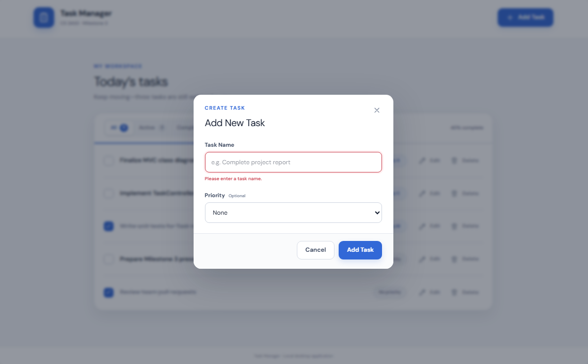
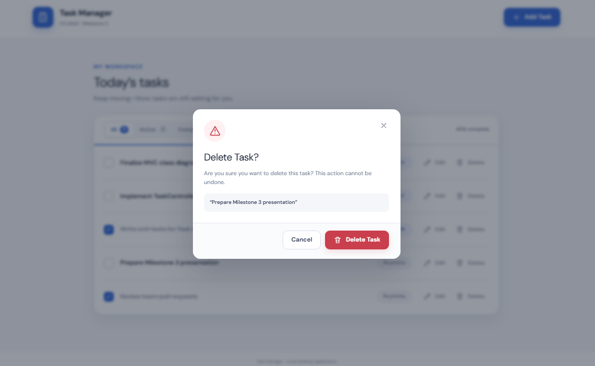
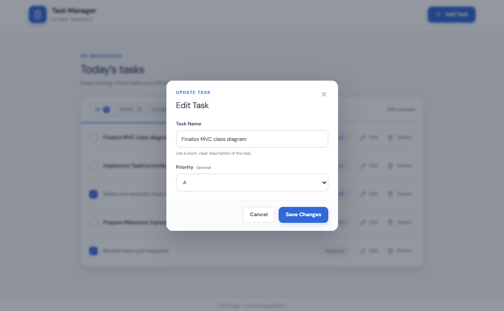
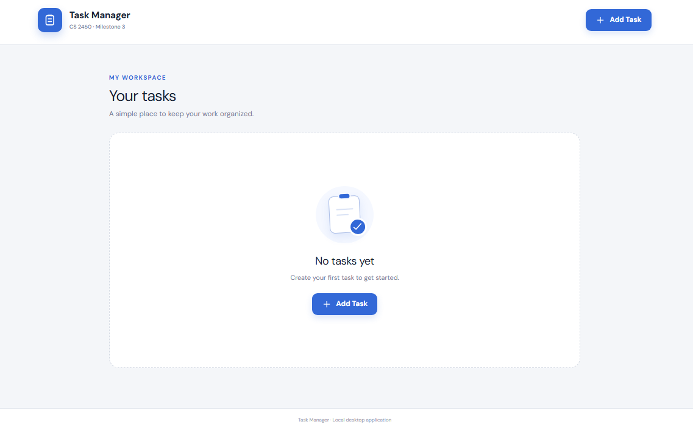
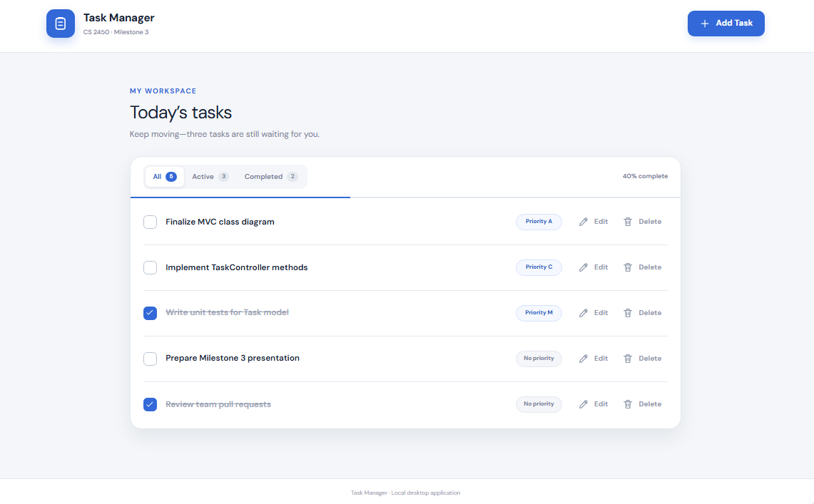

### UI Wireframes

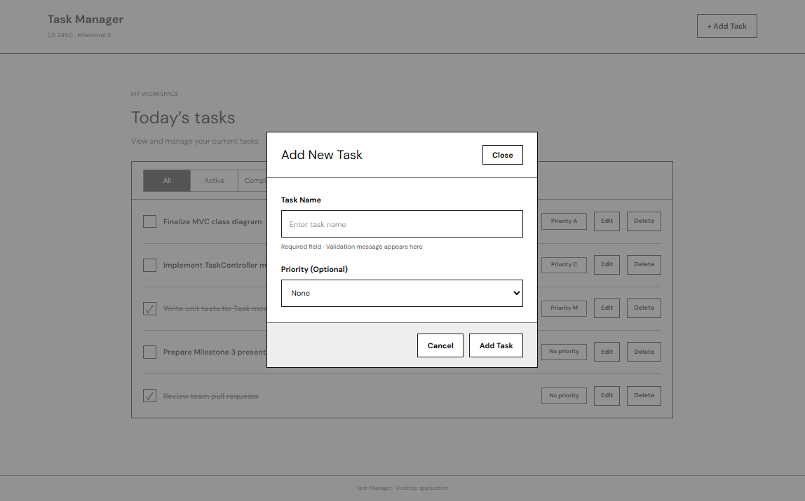
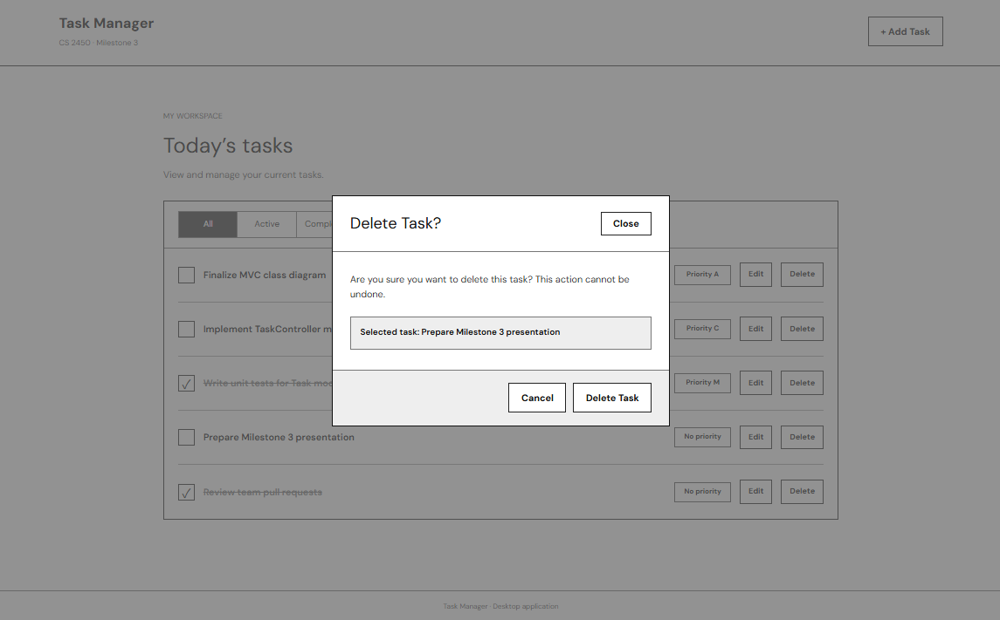
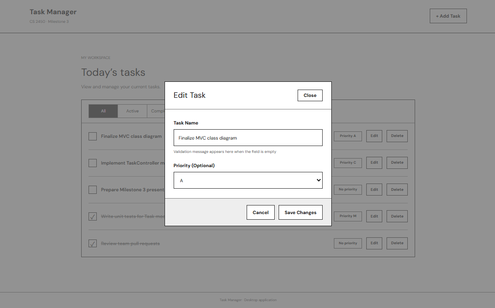
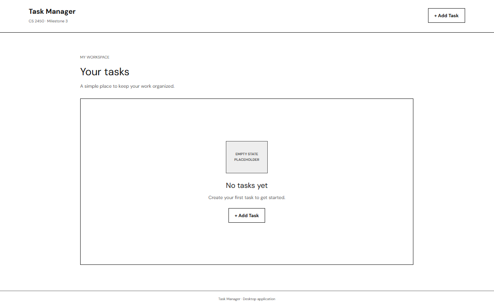
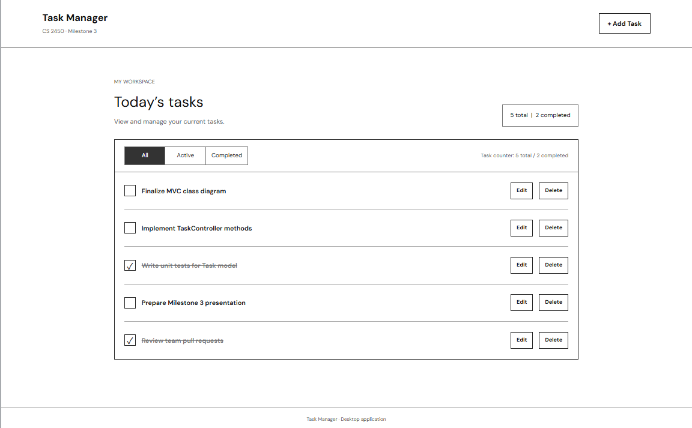

### User Stories (Milestone 1)

| Issue No. | **User Story**                                                                    | **Backlog Issue**          |
| --------- | --------------------------------------------------------------------------------- | -------------------------- |
| 1         | As a busy user, I want to capture a task so I can remember work I need to do.     | Create Tasks Functionality |
| 2         | As a user, I want to see my tasks together so I can plan my work.                 | View Task List             |
| 4         | As a user, I want to mark work complete and reopen it so progress stays accurate. | Complete and Reopen Tasks  |
| 5         | As a user, I want to remove unwanted tasks so my list stays useful.               | Delete Tasks Safely        |
| 8         | As a user, I want to save tasks so my list persists after closing                 | Save Tasks Between Visits  |

## 4. Functional Requirements

Listed below are the functional requirements currently implemented into the Student Task Manager List application.

| ID   | Functional Requirement                                                                                             |
| ---- | ------------------------------------------------------------------------------------------------------------------ |
| FR-1 | The application should allow users to create tasks with a name.                                                    |
| FR-2 | The application should display stored tasks and their completion status.                                           |
| FR-3 | The application should allow users to mark tasks complete or reopen completed tasks.                               |
| FR-4 | The application should allow users to delete existing tasks by name.                                               |
| FR-5 | The application should save tasks to and load tasks from a local text file using the `todo.txt` format.            |
| FR-6 | The application should allow users to edit an existing task's name and priority.                                   |
| FR-7 | The application should support optional task priorities.                                                           |
| FR-8 | The application should sort tasks according to completion status, priority, and task dates when saving.            |
| FR-9 | The application should provide feedback for invalid input, ambiguous task matches, and tasks that cannot be found. |

**Deliverables:** The application provides command-line task management, local file persistence, and task organization functionality.

## 5. Non-Functional Requirements

The following non-functional requirements describe the usability, performance, reliability, platform, and storage expectations of the Student Task Manager application.

| ID    | Category    | Non-Functional Requirement                                                                                                                                       |
| ----- | ----------- | ---------------------------------------------------------------------------------------------------------------------------------------------------------------- |
| NFR-1 | Usability   | The application should provide clear command-line instructions and feedback indicating whether task operations succeed or fail.                                  |
| NFR-2 | Performance | The application should respond promptly to standard task operations, including creating, viewing, editing, and deleting tasks.                                   |
| NFR-3 | Reliability | The application should handle invalid user input and file read/write errors without unexpectedly terminating or reporting unsuccessful operations as successful. |
| NFR-4 | Platform    | The application should be implemented in C++ and operate through a command-line interface.                                                                       |
| NFR-5 | Storage     | The application should store task data in a local plain-text file following the agreed `todo.txt` conventions, allowing tasks to persist between program runs.   |

## 6. Use Cases & UML Diagrams

The Student Task Manager application uses a command-line interface to manage tasks. The system consists of a `task` structure for representing task data and a `task_controller` class responsible for processing commands, managing tasks, and handling file operations

**Primary Actor:** User / Student

### Use Cases

| Use Case      | Related Requirement | User Interaction                                         | Expected Result                                    |
| ------------- | ------------------- | -------------------------------------------------------- | -------------------------------------------------- |
| Create Task   | FR-1, FR-7          | User enters a task name and optional priority.           | A new task is created and saved.                   |
| View Tasks    | FR-2                | User requests the task list.                             | Tasks and their completion statuses are displayed. |
| Complete Task | FR-3                | User identifies an incomplete task.                      | The task is marked complete.                       |
| Reopen Task   | FR-3                | User identifies a completed task.                        | The task is marked incomplete.                     |
| Edit Task     | FR-6                | User identifies a task and provides updated information. | The task's name or priority is updated.            |
| Delete Task   | FR-4                | User identifies a task to remove.                        | The matching task is deleted.                      |
| View Help     | NFR-1               | User requests command instructions.                      | Available commands and their usage are displayed.  |

Task changes are saved to the local `todo.txt` file. The application also loads existing tasks when started, allowing data to persist between executions.

### UML Models

**Use Case Diagram:** Illustrates the interactions between the user and the application's available task-management operations.
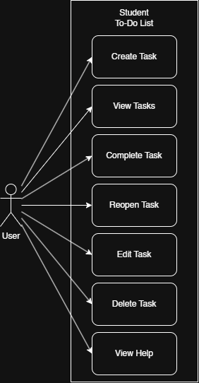

**Class Diagram:** Represents the `task` structure, `task_controller` and `task_view` classes, including their attributes, methods, and relationship.
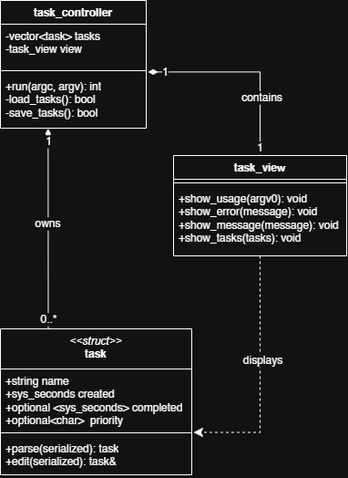

**Program Behavior Diagram:** Illustrates how the application processes command-line arguments, performs task operations, and saves changes.
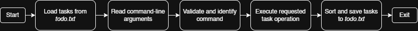

## 7. Assumptions & Constraints

#### Assumptions
- User understands basic CLI usage.
- Application can read/write to the local filesystem.
- Application can run offline.
- Users interact with the program using supported CLI arguments.

#### Constraints
- Application written in C++.
- Application runs through a CLI.
- Persistent task storage will use a file based on the `todo.txt` format.
- The application processes commands through a `task_controller` class and represents individual tasks using a `task` structure.
- Application processes one command per execution. 

**Document Evolution:** This SRS describes the functionality and architecture of the current implementation. Requirements and diagrams will be updated as changes are implemented in future milestones.