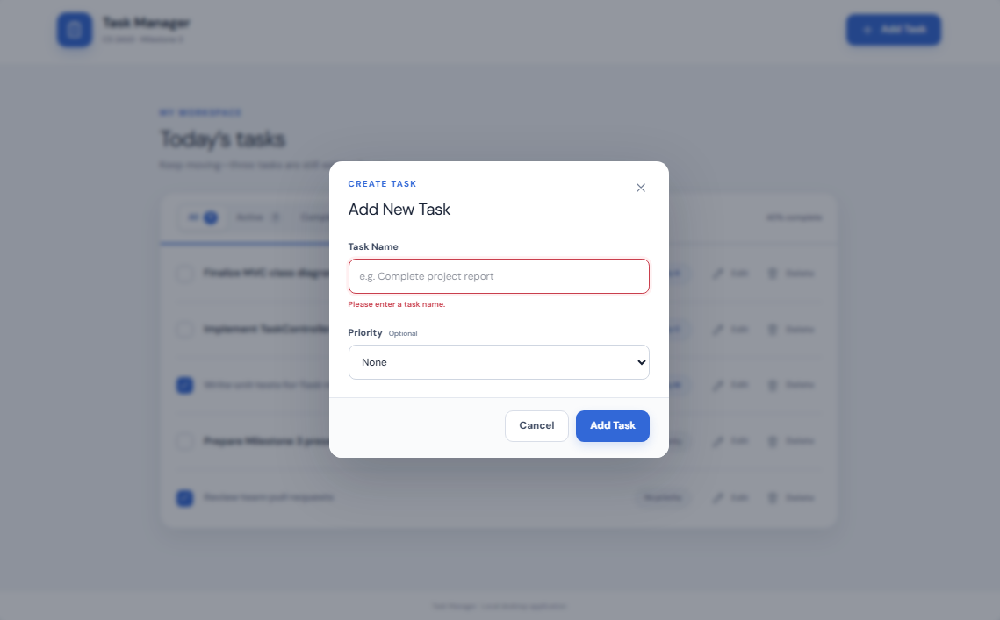
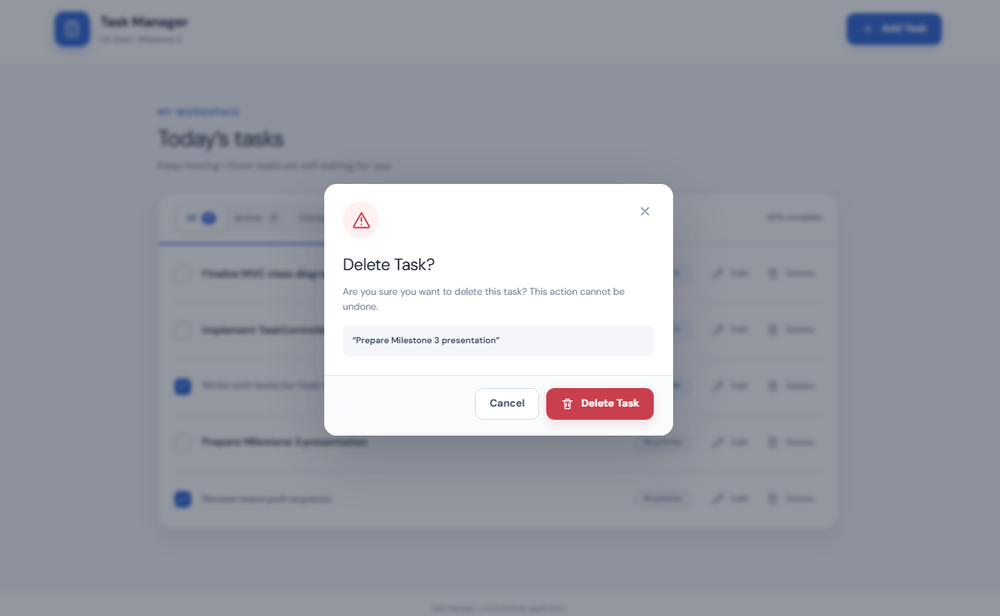
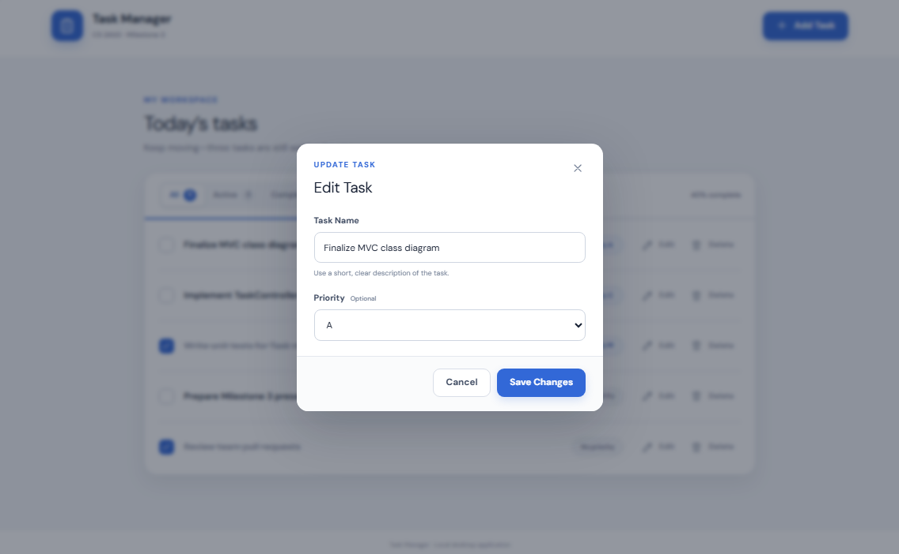
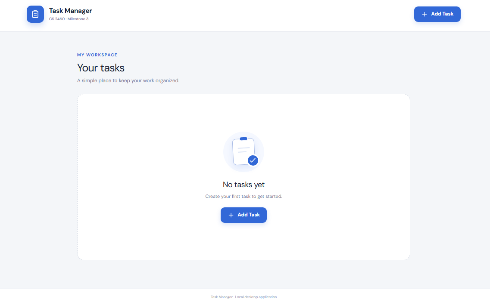
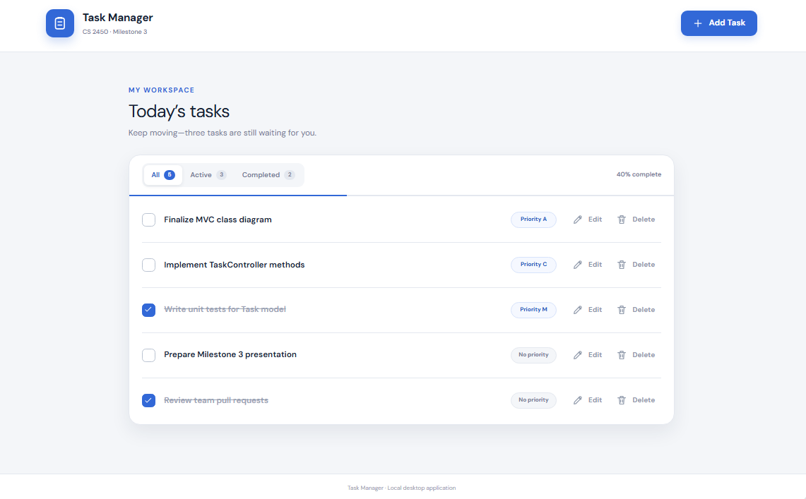
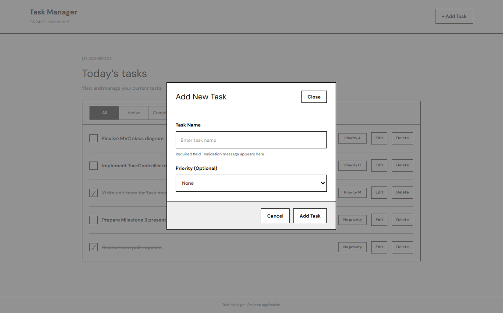
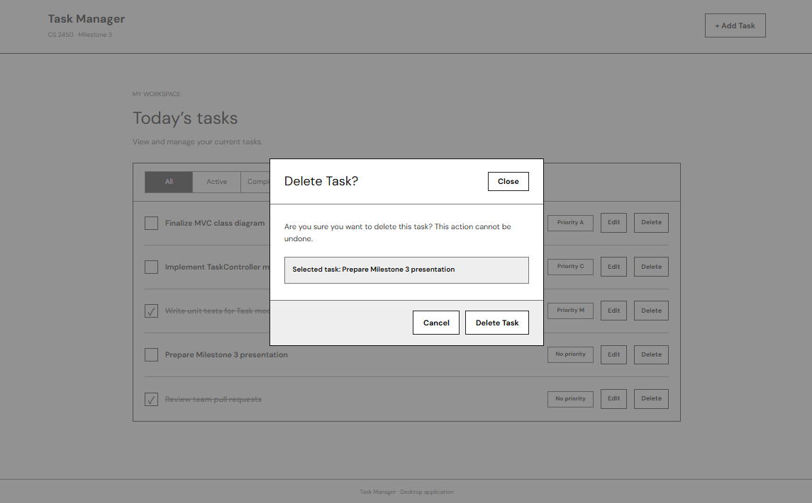
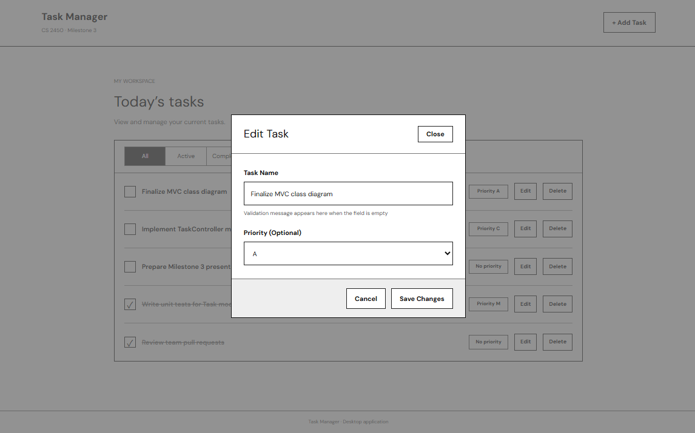
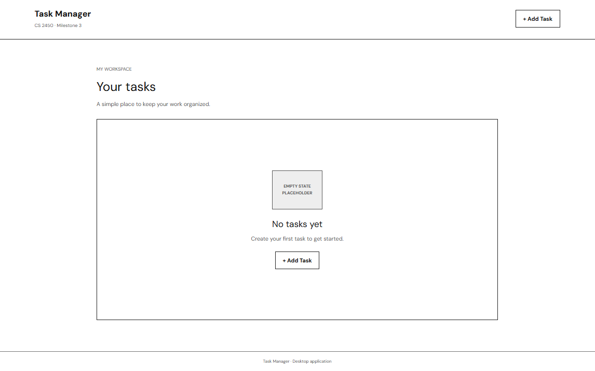
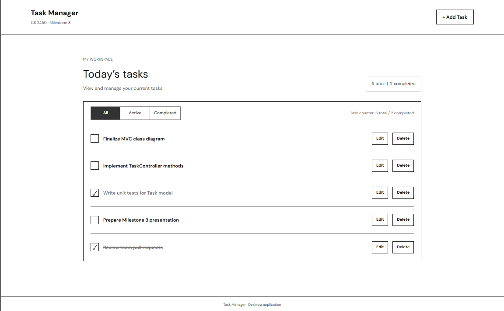

# Software Requirements Specification
## Student Task Manager 

**Version** 4.0  
**Class:** CS-2450-003
**Date:** 11-16-2026
**Team:** Fawn Sannar, Ethan Scott, Porter Sampson, Jimin Ko, Mckley Carmebi Leprince Florestal

## Revision History

| Name   | Date       | Reason For Changes                                                                            | Version |
| ------ | ---------- | --------------------------------------------------------------------------------------------- | ------- |
| Porter | 10-10-2026 | Init - Milestone 2                                                                            | 2.0     |
| Porter | 10-28-2026 | Updated requirements, architecture, GUI and UML models to reflect current development status. | 3.0     |
| Porter | 11-16-2026 | Documented the GUI implementation, added features, and design patterns selected               | 4.0     |

## 1. Introduction & Purpose

This Student Task Manager is a simple application, currently CLI based, designed to help students organize their work. The application provides basic task-management functionality, including creating, viewing, editing, completing, reopening, and deleting tasks. Additional functionality includes task priorities, sorting, and persistent local storage.

This Software Requirements Specification (SRS) documents the application's current requirements, functionality, and system architecture, reflecting changes implemented since the previous milestone.

## 2. Overall Description

The C++ application opens an FLTK desktop window. The All, Incomplete, and Complete tabs show tasks from one shared collection. Users select a row to edit, complete, reopen, or delete the corresponding task. New and Edit use a shared form with an optional priority and due date. Delete prompts for confirmation.
### Architectural Design

| Component         | Responsibility                                                                                                                                                              |
| ----------------- | --------------------------------------------------------------------------------------------------------------------------------------------------------------------------- |
| `main.cpp`        | Owns the `std::vector<task>`, loads `todo.txt`, constructs the controller and view, and saves the vector after the window closes.                                           |
| `task`            | Holds the name, creation timestamp, optional completion timestamp, optional priority, and optional due timestamp. The model defines parsing, serialization, and comparison. |
| `task_controller` | References the vector, exposes a read-only span, and handles task mutations and sorting.                                                                                    |
| `task_view`       | Owns the FLTK widgets, validates form input, maps each tab's selected row to a vector index, calls the controller, and rebuilds the lists after a mutation.                 |
### GUI Design Status

Jimin's Milestone 3 mockups and wireframes document the original GUI design. The implemented interface uses a text field for priority and labels the tabs All, Incomplete, and Complete. The historical assets below use their original paths in the repository.
### UI Mockups

### UI Wireframes

### User Stories (Milestone 1)

| Issue No. | **User Story**                                                                    | **Backlog Issue**          |
| --------- | --------------------------------------------------------------------------------- | -------------------------- |
| 1         | As a busy user, I want to capture a task so I can remember work I need to do.     | Create Tasks Functionality |
| 2         | As a user, I want to see my tasks together so I can plan my work.                 | View Task List             |
| 4         | As a user, I want to mark work complete and reopen it so progress stays accurate. | Complete and Reopen Tasks  |
| 5         | As a user, I want to remove unwanted tasks so my list stays useful.               | Delete Tasks Safely        |
| 8         | As a user, I want to save tasks so my list persists after closing                 | Save Tasks Between Visits  |

## 3. Design Patterns
The design pattern selected in milestone 4 was coded by Jimin, and the selected command pattern reasoning can be found in `/docs/command_pattern.md`
## 4. Functional Requirements

Listed below are the functional requirements currently implemented into the Student Task Manager List application.

| ID    | Functional Requirement                                                                                                                                                                                                                                                                                                                                     |
| ----- | ---------------------------------------------------------------------------------------------------------------------------------------------------------------------------------------------------------------------------------------------------------------------------------------------------------------------------------------------------------- |
| FR-1  | The application should allow users to create a task with a name. The form should reject empty names and names containing only spaces or tabs.                                                                                                                                                                                                              |
| FR-2  | The application should display tasks in All, Incomplete, and Complete tabs, with `[ ]` and `[x]` status markers and any assigned priority or due date.                                                                                                                                                                                                     |
| FR-3  | The application should allow users to complete or reopen the selected task. Completing records the current timestamp and reopening clears it.                                                                                                                                                                                                              |
| FR-4  | The application should allow users to delete the selected task after confirmation. Canceling should preserve the task.                                                                                                                                                                                                                                     |
| FR-5  | The application should load tasks from local `todo.txt` at startup and save the collection when the GUI closes normally. The file uses the project's todo.txt-based conventions, including UTC timestamps and an optional `due:` field.                                                                                                                    |
| FR-6  | The application should allow users to edit the selected task's name, priority, and due date while preserving its creation and completion timestamps.                                                                                                                                                                                                       |
| FR-7  | The application should accept a blank priority or a single letter A–Z, converting lowercase letters to uppercase. A is the highest priority.                                                                                                                                                                                                               |
| FR-8  | The application should sort tasks after adding, editing, or changing completion. Incomplete tasks precede completed tasks. The comparison then uses completion time when present, due date, priority, and creation time. Earlier dates and assigned due dates or priorities take precedence. Startup displays file order until a sorting operation occurs. |
| FR-9  | The application should display form errors for invalid input and prompt users to select a task before editing, deleting, or changing completion.                                                                                                                                                                                                           |
| FR-10 | The application should accept an optional valid due date in `YYYY-MM-DD` form. A new or changed date should be stored at 23:59:59 UTC. Clearing the field should remove the due date.                                                                                                                                                                      |
| FR-11 | When the task lists are rebuilt, the application should label an incomplete task overdue if its due timestamp has passed.                                                                                                                                                                                                                                  |

## 5. Non-Functional Requirements

The following non-functional requirements describe the usability, performance, reliability, platform, and storage expectations of the Student Task Manager application.

| ID    | Category    | Non-Functional Requirement                                                                                                                                                                                                                                  |
| ----- | ----------- | ----------------------------------------------------------------------------------------------------------------------------------------------------------------------------------------------------------------------------------------------------------- |
| NFR-1 | Usability   | The application should provide labeled controls, inline form feedback, and a delete confirmation dialog.                                                                                                                                                    |
| NFR-2 | Performance | The application should respond promptly to routine task operations. A measurable response-time target remains to be defined.                                                                                                                                |
| NFR-3 | Reliability | The application should report file errors and avoid reporting an unsuccessful save as successful. The current implementation reports file-open failures and malformed records to standard error. Detection of write failures after opening remains pending. |
| NFR-4 | Platform    | The application should run as a C++23 desktop GUI built with CMake 3.30 or later and FLTK. The build requests FLTK release 1.4.5 when fetching the dependency.                                                                                              |
| NFR-5 | Storage     | The application should store task data locally in a human-readable text file and support offline operation.                                                                                                                                                 |

## 6. Use Cases & UML Diagrams

**Primary Actor:** User / Student

| ID    | Category    | Non-Functional Requirement                                                                                                                                                                                                                                  |
| ----- | ----------- | ----------------------------------------------------------------------------------------------------------------------------------------------------------------------------------------------------------------------------------------------------------- |
| NFR-1 | Usability   | The application should provide labeled controls, inline form feedback, and a delete confirmation dialog.                                                                                                                                                    |
| NFR-2 | Performance | The application should respond promptly to routine task operations. A measurable response-time target remains to be defined.                                                                                                                                |
| NFR-3 | Reliability | The application should report file errors and avoid reporting an unsuccessful save as successful. The current implementation reports file-open failures and malformed records to standard error. Detection of write failures after opening remains pending. |
| NFR-4 | Platform    | The application should run as a C++23 desktop GUI built with CMake 3.30 or later and FLTK. The build requests FLTK release 1.4.5 when fetching the dependency.                                                                                              |
| NFR-5 | Storage     | The application should store task data locally in a human-readable text file and support offline operation.                                                                                                                                                 |
## 7. Assumptions & Constraints

- Users have access to a desktop environment and permission to read and write `todo.txt` in the working directory.
- The application operates locally with one task collection per run.
- The app saves after the FLTK event loop exits normally. An abnormal exit can lose changes made during that session.
- The entered due date represents a UTC calendar day.
- Command is a proposed implementation design. 

**Document Evolution:** This SRS describes the functionality and architecture of the current implementation. Requirements and diagrams will be updated as changes are implemented in future milestones.